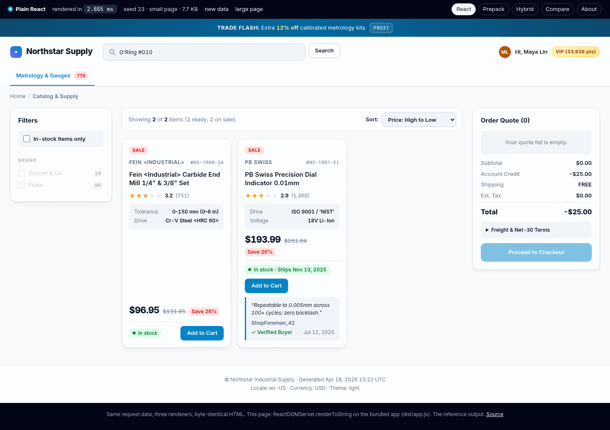
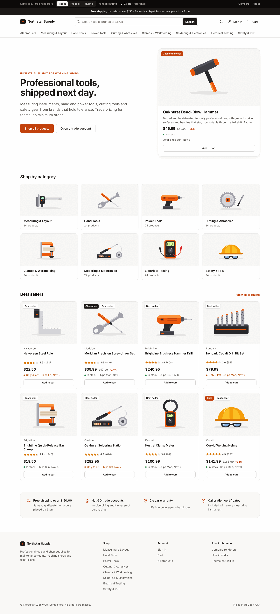
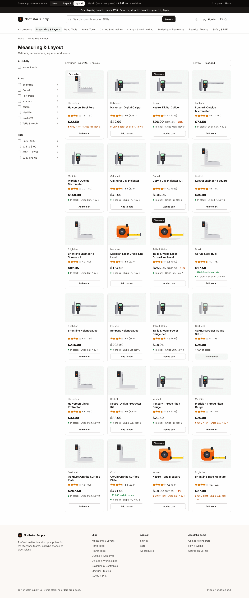
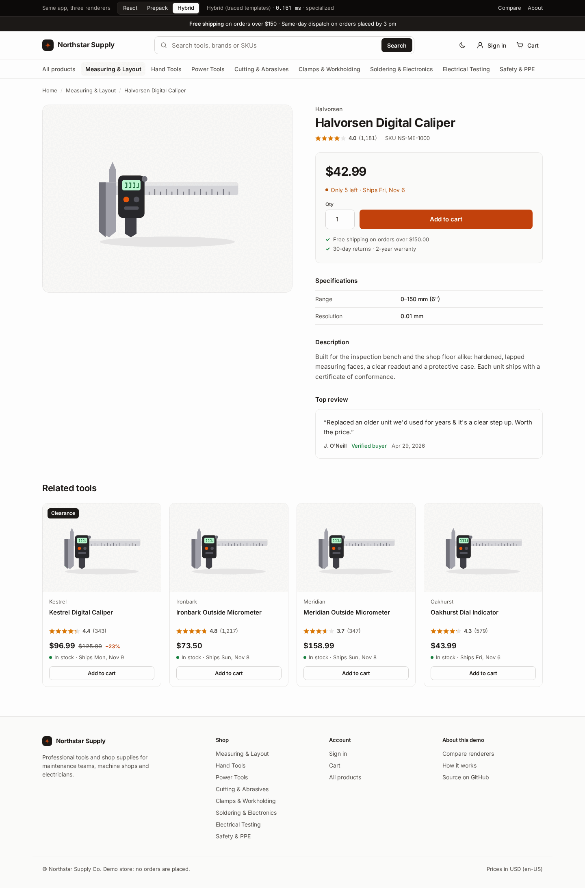
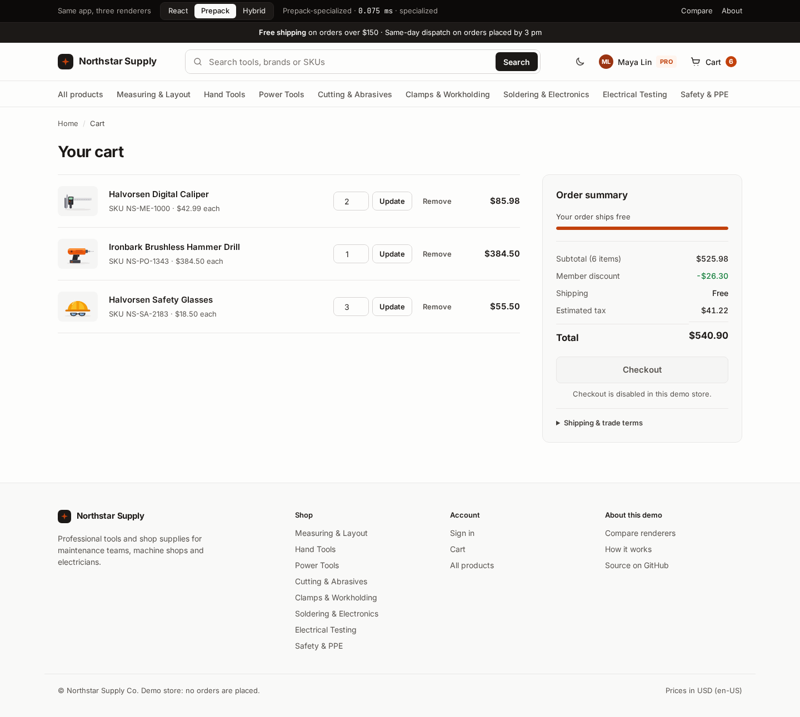
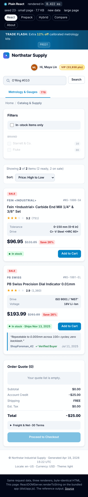
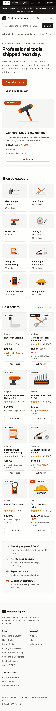

# Northstar Supply: design review and redesign

This review covers the live demo at `https://jamesbox.exe.xyz/northstar/` as it was before the
redesign (commit `52ed967`): the storefront rendered by the three renderers, the landing page and
`/compare`. Screenshots were taken with headless Chromium at 1440 px (desktop) and 390 px
(mobile, 2× DPR). The "before" set is in `docs/screenshots/before/`, the "after" set in
`docs/screenshots/after/`.

## Part 1: critical review of the old design

### The biggest problem: the page was not a store

Before any visual detail, the demo did not behave like a website:

- **Every request rendered random data** (`src/data.js generateRequest` with a random seed). The
  theme (light, dark or a black-and-yellow "contrast" theme), the locale and currency (USD, GBP,
  EUR in two formats, JPY), the signed-in user, the promo banner, the deal of the day, the cart
  and the 0–2 products all changed on refresh. A visitor who reloads sees a different shop, in a
  different currency and colour scheme. This makes it impossible to judge the design at all,
  and it reads as broken.
- **Every link 404ed.** The app's links and forms pointed at the site root (`/catalog?q=…`,
  `/c/metrology`, `/p/NS-1000-SA`, `/signin`, `/register`, `/saved`, `?page=2`), and the server
  only knew `/northstar/{react,prepack,hybrid}`. Search, the category nav, product titles,
  pagination and sign-in all ended on a plain-text "Not found"
  (`before/search404-desktop.png`).
- **Controls that do nothing.** "Add to Cart", "View Deal", "Reset Filters", "Proceed to
  Checkout" were `type="button"` with no form and no script. The sort `<select>` and filter
  checkboxes were not in a form. Nothing on the page could change anything.
- **Nonsense content.** The data was built to stress HTML escaping, so the visible copy was
  `Fein <Industrial> Carbide End Mill`, `Clamps <Workholding>`, a search box prefilled with
  ``, and a review written in Japanese next to a French price. Good
  test data, but it should not be the shop window.

### Layout and grid

- **Three columns compete on every page.** Filters (240 px) | products | "Order Quote" (300 px)
  leaves the product grid only ~800 px at 1440 px, enough for three cards, and on a small page
  the grid holds two cards and a large empty area (`before/home-desktop.png`). The quote aside
  repeats on every page instead of living behind a cart link.
- **No max-width on the shell content and inconsistent gutters.** The header spans the full
  width while the content columns use different internal paddings (24 px, 16 px, 18 px), so left
  edges do not line up: the logo, breadcrumbs, filter card and toolbar sit on four different
  x-positions.
- **Card heights stretch to the tallest card in the row**, so cards with no specs or review get a
  large hole between the title and the price (`before/home-desktop.png`, first card), with
  price and button pinned to the bottom.
- **The nav row overflows** at 1440 px on large pages (the last category, "Test …", is cut off
  at the right edge with no scroll affordance) (`before/large-desktop.png`).

### Typography

- **Thirteen font sizes** in the stylesheet (10, 11, 12, 13, 14, 15, 16, 18, 19, 21, 24, 28,
  34 px) and no scale. Body text is 14 px, below the 16 px most stores use; metadata drops to
  10–11 px uppercase with letter-spacing, which is hard to read.
- **Hierarchy is flat.** Brand (11 px uppercase), SKU (11 px mono), title (15 px semibold),
  spec rows, badges, price (24 px), save chip, stock chip and review all have similar weight and
  each sits in its own tinted box, so the eye has no clear path: brand → title → price → action.
- **Font stack falls through.** `"Inter"` is not self-hosted, so most visitors get the system UI
  font, and in the screenshot environment `system-ui` resolved to a monospace font. There is no
  CJK fallback, which is why the Japanese review text renders as tofu boxes
  (`before/dark-desktop.png`).
- Line length on the landing page is fine (~75 characters), but the compare page's numeric
  columns wrap into two lines on mobile (`77.6 / µs`).

### Colour and contrast (WCAG 2.1 AA, 4.5:1 for text, 3:1 for UI)

| pair | ratio | verdict |
|---|---:|---|
| muted text `#64748b` on `#f8fafc` page | 4.55 | barely passes |
| muted text on `#f1f5f9` tinted boxes (spec lists, empty cart) | 4.34 | **fails** |
| link/accent `#0284c7` on white | 4.10 | **fails** for body text |
| disabled filter labels (45 % opacity) | 2.93 | **fails**; zero-count filters look like a rendering bug |
| disabled "Proceed to Checkout" (white on 50 % accent) | 1.95 | **fails**; looks enabled-but-faded |
| "Sale"/"Save 26 %" `#dc2626` on `#fee2e2`, 11–12 px | 3.95 | **fails** |
| star fill `#f59e0b` on white (non-text) | 2.15 | below 3:1 for meaningful graphics |

- **Too many colours at once.** Sky-blue accent, red sale chips, green stock chips, amber
  low-stock and VIP chips, a red-to-orange or blue gradient promo bar, a navy deal banner, and a
  purple/orange/blue version bar. Nothing reads as *the* action colour.
- **Three themes, chosen at random.** Dark and contrast themes were complete palettes but nobody
  asked for them; the contrast theme's yellow-on-black buttons and white 1 px borders on every
  box look like a different product.

### Components and consistency

- **Pills everywhere.** Category counts, tier badges, stock state, sale %, filter counts, promo
  code and SKU all use pill shapes with different radii (4, 6, 999 px) and paddings.
- **Buttons**: primary is filled sky-blue, secondary is outlined, "ghost" is text-only; sizes
  vary between 32, 36 and 44 px tall; "Add to Cart" and "Notify Me" sit next to a stock chip and
  shift position depending on the chip's length.
- **The search button** is a separate outlined box next to a tinted input, visually heavier
  than the input itself, and the header's search sits on the same row as a long greeting
  ("Hi, A. "Rusty" Kowalski") and a points badge that push it around.

### Imagery

- **No product images.** An e-commerce grid without imagery is a spreadsheet. Cards rely on text
  and tinted boxes for visual interest. There is not even a placeholder shape to make the grid
  scannable by category.

### Affordances, states and accessibility

- Focus states exist only as the browser default on some controls; cards have a hover lift but
  only the title is a link, so the lift promises a click target that is mostly not there.
- The disabled search input and read-only states from the test data render as greyed-out
  fields with no explanation.
- Empty states: "No matching products found" with a "Reset Filters" button that does nothing;
  the empty quote shows a full breakdown with `Account Credit −$25.00` and `Total −$25.00`
  (`before/home-desktop.png`), a negative total for an empty cart.
- There is no 404 page, no results header for searches ("Results for …"), and no indication of
  which filters are active.

### Mobile (390 px)

- The version bar wraps into four rows (≈ 110 px) and the promo bar into three before the
  store's logo appears (`before/home-mobile.png`, `before/large-mobile.png`): the first product
  is two screens down.
- The filter card renders open, full width, above the products (~600 px on large pages).
- The category nav is a horizontally clipped row with no visible scroll affordance.
- Header elements stack in source order (logo, greeting, badge, search) instead of a compact
  bar with search.

### Demo chrome

- The version bar is heavy (black, coloured dots, pill links, `new data`/`large page` actions)
  and visually louder than the store. The footer repeats a long technical sentence on every
  page. The landing and compare pages use a separate dark gradient style unrelated to the store.

## Part 2: the redesign

### What changed in behaviour (the prerequisites)

- **A real store.** `store/catalog.js` holds a fixed catalog (8 categories × 24 products, generated
  once from a fixed seed: same products, prices and stock on every visit). `store/page.js` builds the
  app's data from that catalog plus the request: route, query, sort, filters, page, and cookies for
  the cart, theme and signed-in state. Defaults: light theme, en-US / USD, signed out, empty cart.
  The random generator in `src/data.js` is kept, only for the benchmark corpus.
- **Every link works under the base path.** The app gets `data.nav` (`base` = the current
  renderer's prefix such as `/northstar/hybrid`, `assets`, `view`, `path`, `current`) and builds
  every link and form action from it. The server implements home, all products, category, search,
  product detail, cart, a sign-in stub and an app-rendered 404, plus form posts for add to cart,
  quantity update/remove, theme and sign in/out. Every route exists in all three renderers.
- **Controls do something, without JavaScript.** Filters and sort are one GET form (the sort
  `<select>` joins it with `form="ns-filter-form"`); a 6-line script in the page shell only
  auto-submits on change and collapses the filter panel on phones. Add-to-cart is a POST form.

### Design decisions

| area | before | after |
|---|---|---|
| type | 13 sizes, 14 px body, system font fallback (monospace in some environments) | self-hosted Inter (variable, latin + latin-ext, 133 KB), 8-step scale 12/13/14/15/18/22/28/48 px, 15 px body, tight tracking on headings only |
| colour | sky blue + red + green + amber chips + gradients, three random themes | warm neutral greys, one accent (safety orange `#c2410c`, white text 5.2:1) for primary actions, sale prices and focus; green/amber only for stock state; optional dark theme behind a header toggle (cookie) |
| contrast | muted text 4.34:1 on tinted boxes, disabled controls 1.95–2.93:1 | body muted text `#57534e` 7.6:1, faint `#78716c` 4.8:1 (counts, placeholders), disabled buttons use a neutral fill with 7.0:1 text, accent text 5.2:1, dark theme muted `#a8a29e` 6.9:1 on `#1c1917` |
| layout | filters / products / quote in three columns, no max width | 1280 px container, 24 px gutters, two columns on listings (232 px filters, 4-column card grid at 1440 px), cart moved to its own page behind a header link with a count badge |
| header | logo, search, greeting, points badge in one row; nav row overflowing | sticky, translucent: logo, a 640 px search with an inline submit, then theme / account / cart icons; category row scrolls horizontally with an edge fade on small screens |
| cards | tinted sub-boxes for specs, price, stock and review; holes from equal heights | image panel, brand, 2-line clamped title (fixed height), stars, price, stock line, full-width add-to-cart; the whole card is one link (stretched title link) with hover border + shadow and a visible focus ring |
| imagery | none | 24 flat SVG illustrations in one palette (3 per category, chosen by product type), on a neutral panel; decorative (`alt=""`), lazy-loaded below the fold |
| price | 24 px price, red "Save 26 %" chip, strike-through | 18 px (30 px on the product page) bold price, muted strike-through with a screen-reader "Was", accent "−26 %" |
| states | empty search shows "Reset Filters" that does nothing; negative total on an empty quote | search results header ("Results for “drill”"), active-filter chips that remove themselves, empty states with next steps and category links, an empty-cart page, a 404 page with links, one-time confirmations ("Added … to your cart") |
| mobile | 4-row demo bar, 3-row promo, open filters above products | 40 px demo bar, header = logo + icons, full-width search below; filters collapse into a disclosure; 2-column card grid; cart rows reflow |
| demo chrome | loud bar with coloured dots; separate dark-gradient doc style | one quiet near-black bar: a segmented React / Prepack / Hybrid switch that keeps the current URL, the render time, and "specialized" or "fell back to React"; landing and compare pages use the store's palette and type |

### Before and after

| page | before | after |
|---|---|---|
| home, desktop | `before/home-desktop.png` | `after/home-desktop.png` |
| home, mobile | `before/home-mobile.png` | `after/home-mobile.png` |
| large listing | `before/large-desktop.png`, `before/large-mobile.png` | `after/large-desktop.png`, `after/large-mobile.png` (View all, 192 products) |
| category | – | `after/category-desktop.png`, `after/category-mobile.png` |
| search | `before/search404-desktop.png` (404) | `after/search-desktop.png`, `after/search-empty-desktop.png` |
| product page | – | `after/product-desktop.png`, `after/product-mobile.png` |
| cart | (quote aside in `before/home-desktop.png`) | `after/cart-desktop.png`, `after/cart-mobile.png` |
| sign in, 404 | – | `after/signin-*.png`, `after/notfound-*.png` |
| dark theme | `before/dark-desktop.png`, `before/contrast-desktop.png` | `after/dark-desktop.png`, `after/dark-category-desktop.png` |
| compare | `before/compare-desktop.png`, `before/compare-mobile.png` | `after/compare-desktop.png`, `after/compare-mobile.png` |
| landing | `before/landing-desktop.png` | `after/landing-desktop.png` |

 

### Known limits

- Product art is illustrative: one drawing per product type, so a category page repeats each
  drawing a few times.
- The dark theme keeps light image panels so the illustrations stay legible.
- Checkout is intentionally disabled; sign-in accepts any input and uses a sample trade account.
